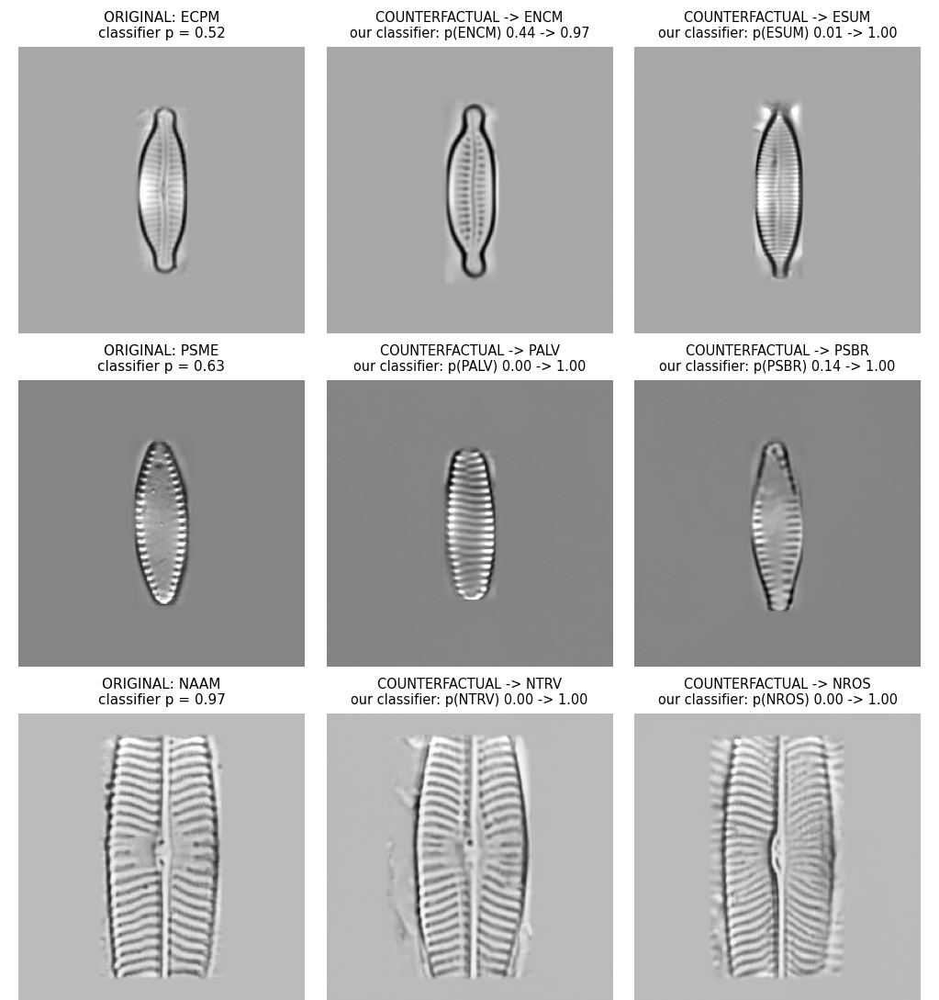
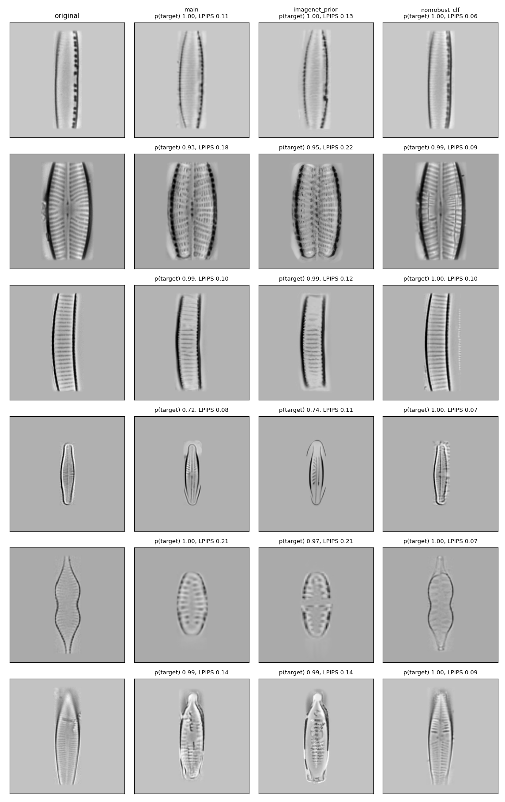
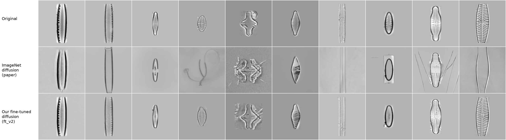
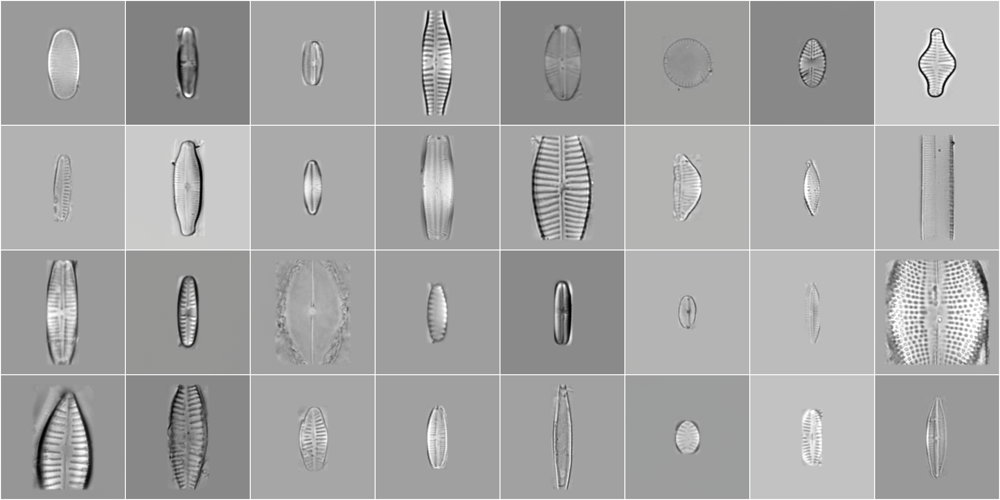

<div align="center">

# Diffusion Visual Counterfactual Explanations for Diatom Classification


[Original DVCE code](https://github.com/valentyn1boreiko/DVCEs)

</div>

**What would this microalga have to look like for a neural network to call it a
different species?**

This project answers that question for **diatoms**, single-celled algae that
biologists use to monitor water quality. It adapts **Diffusion Visual
Counterfactual Explanations (DVCEs)**
([Augustin et al., NeurIPS 2022](https://arxiv.org/abs/2210.11841)), developed on
ImageNet, to light microscopy. For a real diatom of species A, the pipeline
generates a minimally changed, realistic image that the classifier assigns to
a related species B, which makes visible what the model has learned to separate
the two species.



*Real test diatoms (left) and diffusion counterfactuals towards two species of
the same genus. Titles give the robust classifier's probability for the target
species, before → after.*

## Abstract

Deep classifiers identify diatom species from light-microscopy images with high
accuracy, but it is unclear which morphological traits they rely on. We adapt
Diffusion Visual Counterfactual Explanations (DVCEs) to diatoms. Given a
specimen of species A, DVCE generates a minimally changed, realistic image that
an adversarially robust classifier assigns to a related species B.

To make this work outside natural images, we:
- fine-tune a 256×256 diffusion model on 32k DIATLAS images, cutting
  perceptual reconstruction error by 64% compared with the ImageNet prior and
  preserving specimen size
- adversarially train a 759-species ResNet-50 (90.9% clean, 81.8% under L2
  attack at ε = 1)
- choose targets within the same genus, the taxonomic analogue of WordNet
  neighbourhoods

On 301 unseen test specimens, 93.9% of 602 counterfactuals reach the target
species, and the changes concentrate 37× more on the specimen than on the
visible background. A classifier trained only on other atlas pages, which never
saw the sources, predicts the target species for 56.5% of the counterfactuals
(4.8% on the originals), and automatically measured traits move towards the
target species in 68–87% of cases. Explanations of a classifier trained on
held-out pages change the same traits. We also show that the evaluation split changes what accuracy
means on DIATLAS: random image splits measure recognition within known samples,
while holding out whole atlas pages measures generalisation to new samples and
roughly halves species-level accuracy.

## Method

```
DIATLAS ──► native-size preprocessing (crop 224, canvas 256) ──► page-aware splits
                                   │
            ┌──────────────────────┴──────────────────────┐
            ▼                                             ▼
  diffusion prior: OpenAI 256×256              robust classifier: ResNet-50
  unconditional DDPM, fine-tuned               (Madry ImageNet init), L2 PGD
  on diatoms (30k steps)                       adversarial training, ε = 1.0
            │                                             │
            └────────────► DVCE guided sampling ◄─────────┘
                    (classifier sees the center 224 crop)
```

- **Preprocessing.** Specimens keep their native pixel size, so the diffusion
  prior keeps their size and counterfactuals can show size changes. (For the
  classifier alone, stretching is not worse: in a controlled test stretched
  images reach 51% vs 43% for native-size crops, because cropping hides the
  ends of long diatoms; see `diatoms/COMMANDS.md` section 20.) Images longer than 224 px are center-cropped and
  placed on a 256×256 canvas with seamless padding. The center 224×224 crop is
  the classifier input; the full canvas is the diffusion input.
- **Targets.** For each source specimen, two species of the same genus are
  sampled at random, the diatom counterpart of the "same WordNet cluster"
  rule of the original paper.
- **DVCE settings.** Paper defaults: 200 respaced steps, start at step 100,
  classifier guidance 0.1, L1 distance regularisation 0.15.

## Results

### Counterfactuals

602 counterfactuals for 301 test specimens; neither model saw these images
during training.

| Metric | Value |
|---|---|
| Target reached | **93.9%** (median p(target) 0.99) |
| p(target), before → after | 0.008 → 0.887 |
| LPIPS to the original | 0.171 |
| Change on specimen / background, within the classifier's 224 crop | **37×** |
| Classifier trained on held-out atlas pages predicts the target | **56.5%** (4.8% on the originals) |
| Third-party ResNet-18s predict the target (may have seen the test pages) | 26.2% robust / 25.9% non-robust |

A second random seed gives the same numbers within noise (94.4% reached,
LPIPS 0.169, held-out-page agreement 57.8%).

Selected best, typical and failure cases:
[`results/dvce/full_r50eps1_ftv2/selection/`](results/dvce/full_r50eps1_ftv2/selection/).

### Do counterfactuals change diagnostic traits?

Traits measured automatically on originals, counterfactuals and real training
photos of each target species (chance = 50%):

| Trait | Moves towards the target species | Non-robust classifier (control) |
|---|---|---|
| Length | **82%** | 54% |
| Width | **70%** | 48% |
| Elongation (length / width) | **87%** | 56% |
| Stria period | **68%** | 41% |

All full-run rates p < 1e-10 (602 counterfactuals). Details:
[`results/traits/summary.txt`](results/traits/summary.txt), `diatoms/COMMANDS.md` section 19.

### Does quality depend on how much training data a species has?

Yes, mainly through the **source** species. Specimens of species with 20–39 training images reach the
target in only 74% of cases, against 97–98% with 80 or more, and their edits are larger. Rare species are
mostly long, cropped diatoms, but in a joint regression training-set size, not cropping, predicts whether
the target is reached. Cropping predicts larger edits and lower transfer. Details are in
`diatoms/COMMANDS.md` section 25.

### Ablations: is each component needed?

Same 50 test specimens and 100 targets, one component swapped at a time.
"Transfer": the target is also predicted by the classifier trained on
held-out atlas pages (it never saw the sources).

| | Target reached | LPIPS | Change on specimen / background (224 crop) | Transfer |
|---|---|---|---|---|
| **Full model** (fine-tuned prior, robust ResNet-50) | 98% | 0.170 | 39× | **56%** |
| ImageNet prior instead | 99% | 0.201 | 30× | 47% |
| Non-robust classifier instead | 98% | 0.063 | 53× | 4% |
| SVCE (another counterfactual method, no diffusion prior) | 100% | 0.318 | 5× | 35% |

- **The robust classifier is essential.** Explaining a standard classifier
  gives near-invisible, adversarial-like edits that flip it but almost never
  convince an unrelated robust model.
- **The diffusion prior keeps edits on the specimen:** SVCE reaches the target
  with stroke artefacts all over the background.
- **The fine-tuned prior makes edits smaller and more local** (LPIPS lower for
  82/100 counterfactuals, p = 6e-13). Transfer is higher too (56% vs 47%, not
  significant on 100 counterfactuals). The ImageNet prior adds non-diatom
  artefacts.

### Do the explanations depend on the training split?

The same robust ResNet-50 trained on held-out atlas pages (37% test accuracy)
was explained on the same 50 specimens; a second random seed of the main run is
the noise floor.

| Compared with the main run | Seed 2 | Page-split classifier |
|---|---|---|
| Traits changed in the same direction | 85% | **84%** |
| Main counterfactuals convince the page-split classifier | — | **76%** |

The explanations change the same traits, and the random-split classifier's
counterfactuals convince a classifier trained across pages.

**Background swaps.** Pasting specimens onto backgrounds from other atlas pages
barely changes the classifier (100% → 97.5%), and the background alone never
gives the species. A counterfactual's specimen on the original background still
gives the target (85.9%); the original specimen on the counterfactual's
background does not (4.2%). See `diatoms/COMMANDS.md` section 22.



*Columns: original; full model; ImageNet prior; non-robust classifier.*

### Diffusion prior



*Rows: test specimen; reconstruction from the DVCE starting noise level with
the ImageNet prior; with the fine-tuned prior.*

| 32 test specimens | ImageNet prior | Fine-tuned prior |
|---|---|---|
| LPIPS ↓ | 0.286 | **0.103** |
| Length ratio (1 = preserved) | 1.23 | **1.02** |
| Length changed > 10% | 17/32 | **2/32** |

**Diatoms generated by the fine-tuned model** (32 samples from pure noise, not
real images):



For comparison, samples from the ImageNet prior:
[`samples_imagenet.png`](results/diffusion/samples_imagenet.png).

**More reconstructions** (same noisy input for both priors; rows alternate
original / reconstruction):

| | ImageNet prior | Fine-tuned prior |
|---|---|---|
| 32 test specimens | [`native_recon_imagenet.png`](results/diffusion/native_recon_imagenet.png) | [`native_recon_ft_v2.png`](results/diffusion/native_recon_ft_v2.png) |
| 16 test specimens | [`recon_imagenet_native.png`](results/diffusion/recon_imagenet_native.png) | [`recon_ft_v2_030000.png`](results/diffusion/recon_ft_v2_030000.png) |
| Close-ups: original \| reconstruction \| difference | [`recon_imagenet_native_pairs.png`](results/diffusion/recon_imagenet_native_pairs.png) | [`recon_ft_v2_030000_pairs.png`](results/diffusion/recon_ft_v2_030000_pairs.png) |

Both priors side by side on 8 specimens:
[`native_recon_closeups_3models.png`](results/diffusion/native_recon_closeups_3models.png).
This figure also shows a first fine-tuned prior trained on stretched images,
which enlarged small diatoms.


## Installation

```bash
git clone https://github.com/saalikmubeen/diffusion-counterfactuals-diatoms.git && cd diffusion-counterfactuals-diatoms
conda env create -f python_38_dvces.yml
conda activate python_38_dvces
```

Python 3.8, PyTorch 1.9, CUDA 11.1; notes for RTX 3090 GPUs in
[`env.md`](env.md).

## Data and checkpoints

| Resource | Source | Location |
|---|---|---|
| DIATLAS dataset | [Zenodo 16260887](https://zenodo.org/records/16260887) | any path, set `--root` |
| OpenAI 256×256 unconditional diffusion model | see [`README_DVCE_original.md`](README_DVCE_original.md) | `checkpoints/256x256_diffusion_uncond.pt` |
| Robust ImageNet ResNet-50 (Madry + FT) | see [`README_DVCE_original.md`](README_DVCE_original.md) | `ImageNet1000Models/Madry_l2_improved/` |
| Fine-tuned diatom diffusion model, robust diatom classifier | trained with the commands below | `checkpoints/diatlas/`, `DiatlasModels/` |

## Usage

**1. Preprocess DIATLAS**
```bash
python diatoms/prepare_diatlas.py --root /path/to/diatlas
python diatoms/prepare_diatlas_nativesize.py --root /path/to/diatlas
```

**2. Fine-tune the diffusion model** (2 GPUs, ~19 h)
```bash
GPUS=0,1 RUN=ft_v2_nativesize bash diatoms/train_diffusion.sh --total_steps 30000 \
    --data_root data/diatlas_nativesize_crop224_canvas256
```

**3. Train the robust classifier** (1 GPU, ~2 h)
```bash
python diatoms/train_classifier.py --run r50madry_random_eps1.0 --split_mode random \
    --init madry_r50 --eps 1.0 --augment strong --epochs 20
```

**4. Generate and evaluate counterfactuals** (2 GPUs, ~6 h for 301 specimens)
```bash
python diatoms/select_pairs_paper.py --ckpt DiatlasModels/r50madry_random_eps1.0/best.pt \
    --n 0 --all_per_species --out evaluation/vce_pairs_paper_all.json
NAME=full PAIRS=evaluation/vce_pairs_paper_all.json bash diatoms/run_dvce_experiment.sh
```
Outputs go to `results/dvce/<NAME>/`:
- `figures/` (original, counterfactuals and real reference photos per specimen)
- `metrics.csv`
- `summary.txt`

## Reproducing the results

| Result | Command (details in [`diatoms/COMMANDS.md`](diatoms/COMMANDS.md)) |
|---|---|
| Counterfactual table | usage step 4 → `results/dvce/full/summary.txt` |
| Trait table | `diatoms/trait_check.py` (section 19) |
| Clean evaluator, preprocessing test, split dependence | sections 20–21 |
| Ablation table | `run_dvce_experiment.sh` with `DIFFUSION=…` / `CLASSIFIER=independent`, then `diatoms/compare_dvce_runs.py` (section 18) |
| Diffusion prior table | `diatoms/sample_diffusion.py --mode recon` + `diatoms/recon_metrics.py` (section 16) |
| Split table | `diatoms/train_classifier.py --labels independent759 / species_pages3 / genus_train100` (section 13) |

## Limitations

- **Cropping and rare species:** 46% of specimens exceed 224 px and lose their ends (larger edits,
  lower transfer). Counterfactuals are less reliable for species with few training images, and species
  with fewer than 20 were not tested.
- **Split:** the explained classifier is trained on a random image split. A
  page-split classifier gives explanations that change the same traits, but it
  is much weaker (37%) and the comparison uses 50 specimens.
- **Edit size:** some counterfactuals redraw rather than minimally edit the
  specimen (median LPIPS 0.165). Stronger regularisation reduces edits at the
  cost of success rate.
- **No expert validation yet:** measured traits move towards the target, but whether the changes match the traits
  diatomists use has not been judged by a specialist.


## Acknowledgements

This repository builds on the official DVCE implementation
([valentyn1boreiko/DVCEs](https://github.com/valentyn1boreiko/DVCEs); original
README: [`README_DVCE_original.md`](README_DVCE_original.md)) and on guided
diffusion (Dhariwal & Nichol, NeurIPS 2021).
