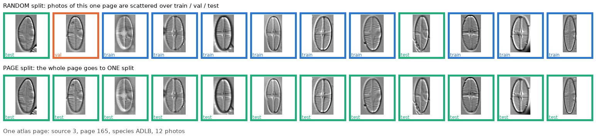

# Random split vs page split: why accuracy is so different

## What a "page" is

DIATLAS was made by cutting photos out of **printed diatom atlases** (PDF
books). One **page** of such a book usually shows **one species**: the authors
photograph several specimens from the same sample, with the same microscope
and settings, and print them side by side. Each photo became one image in the
dataset.

The picture shows one real page: Bourgogne atlas (source 3), page 165,
species ADLB, 12 photos. The photos look very alike: same species, same
sample, same microscope, similar grey background. They're like 12 photos of
siblings taken at the same photo shoot.

(Numbers: 1,920 pages in total; almost every page holds a single species; a
page has ~19 photos on average.)

## What the two splits do with one page

- **Random split (top row):** every photo is assigned on its own. Here 9 went
  to **train** (blue), 1 to **val** (orange), 2 to **test** (green). The model
  trains on 9 siblings and is tested on the other 2. Easy: they look almost
  like what it trained on.
- **Page split (bottom row):** the **whole page** goes to one split, here all
  12 to test. The model never saw any photo from this page. It has to
  recognise ADLB from **other pages** (other samples, microscopes,
  backgrounds). Harder, and the realistic case of a new sample.

## Why that makes accuracy so different

With the random split, **1,597 of the 1,920 pages** have photos in both
training and test, so almost every test photo has siblings in training.

| Same kind of robust ResNet-50, 759 species | Test photos come from … | Accuracy |
|---|---|---|
| random split | pages **seen** in training | ~88% (validation, epoch 10) |
| page split | pages **never seen** in training | ~43% |

The independent classifier's ~86% most likely comes from a random split too.

**Analogy:** to test if someone can recognise a person, you show them photos
from the **same photo shoot** they studied (easy: same clothes, same light),
or photos from a **different day** (hard: only the face itself helps). The
random split is the first test, the page split the second.

## Are we cheating?

No:
- train, val and test never share an image; each image's split is fixed by
  a hash of its path
- exact duplicate photos are negligible: 10 pairs out of 33,621 images

The two splits answer different questions:
- **random split:** "does the model recognise photos like the ones it has seen?"
- **page split:** "does it recognise the species in a new sample?"
