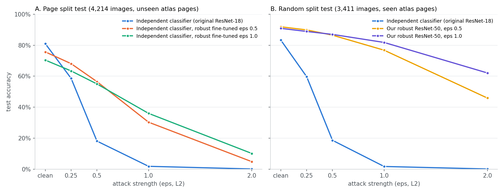

# Diatom classifiers: accuracy and robustness

All models classify the 759 DIATLAS species (`species_code`). They get the
the PadCropDiatom preprocessing (native pixel size, center crop 224×224). Attack =
L2 PGD, 10 steps; **eps** = attack strength. eps 0.5 is invisible to the eye:
about 0.3 grey levels per pixel on average.

## The models

| Model | What it is |
|---|---|
| **Independent classifier (original)** | an independently trained ResNet-18, normal training (not robust) |
| **Independent classifier, robust fine-tuned** (eps 0.5 / 1.0) | that ResNet-18, fine-tuned by us with adversarial training on our page-split training data |
| **Our robust ResNet-50** (eps 0.5 / 1.0) | ResNet-50 started from the robust ImageNet model of the DVCE paper (Madry), adversarially trained by us on a random-split training set |

## Data splits

33,581 images of the 759 species (DIATLAS minus side views and images without
a species code), split in two ways:

| Split | Train | Val | Test | Used for |
|---|---|---|---|---|
| **Page split**: whole atlas pages go to one split | 23,494 (70%), 756 species | 5,873 (17.5%), 346 species | 4,214 (12.5%), 339 species | robust fine-tuning of the independent classifier (table A) |
| **Random split**: each image assigned at random | 26,921 (80%), 756 species | 3,249 (10%), 578 species | 3,411 (10%), 587 species | our robust ResNet-50 (table B) |

Val is used to pick the best training epoch, test only for the numbers below.
The page split's proportions aren't exactly 80/10/10 because whole pages are
kept together. See `RANDOM_VS_PAGE_SPLIT.md` for the difference.

## A. Page split test

Test images come from atlas pages that were not in our training data.
4,214 images, 339 species.

| Model | Clean top-1 | Clean top-5 | eps 0.25 | eps 0.5 | eps 1.0 | eps 2.0 |
|---|---|---|---|---|---|---|
| Independent classifier (original) | **81.0%** | 85.2% | 58.6% | 18.1% | 1.8% | 0.1% |
| Independent classifier, robust eps 0.5 | 75.7% | **85.7%** | **68.1%** | **56.5%** | 30.3% | 4.8% |
| Independent classifier, robust eps 1.0 | 70.4% | 83.6% | 63.4% | 55.0% | **36.0%** | **10.1%** |

## B. Random split test

| Model | Clean top-1 | Clean top-5 | eps 0.25 | eps 0.5 | eps 1.0 | eps 2.0 |
|---|---|---|---|---|---|---|
| Independent classifier (original) | 83.3% | 86.5% | 59.7% | 18.6% | 1.7% | 0.1% |
| **Our robust ResNet-50, eps 0.5** | **91.9%** | **98.7%** | **89.9%** | 86.5% | 76.8% | 45.9% |
| **Our robust ResNet-50, eps 1.0** | 90.9% | **98.7%** | 88.9% | **87.0%** | **81.8%** | **62.1%** |

## Plot

## Summary

- The **original independent classifier** is accurate on clean images, but tiny
  invisible changes fool it: 18% correct at eps 0.5, 2% at eps 1.0.
- **Adversarial fine-tuning** of the independent classifier makes it about 3× more robust at
  eps 0.5, for 5–11 points of clean accuracy (table A).
- **Our robust ResNet-50** is both more accurate (91–92% clean) and far more
  robust (87% at eps 0.5, 82% at eps 1.0 for the eps 1.0 model) (table B).
- For counterfactual explanations we plan to use **our robust ResNet-50,
  eps 1.0**: almost the same clean accuracy as eps 0.5, and more robust
  against stronger attacks.
- Tables A and B use **different test sets**: compare models within a
  table, not across. Random-split numbers measure recognition of seen atlas
  pages. On unseen pages (page split), 759 species reach about 43%; the 92
  species with ≥3 training pages reach about 81%.
